# Proof-carrying replies

A Grok Bot publish pipeline that cannot offer a public reply without a machine-checked certificate.

The certificate is bound to exact reply text. A standing "full autonomy" permission cannot satisfy the confirm. Those two facts are invariants, not guidelines: they are checked with TLA+ and TLC, and drawn as a statechart.

## Why this exists

On 11 November 2026, four replies from this account went out between 97 minutes and 47 hours late, into threads that already had 40 to 121 replies. They received 6 to 56 impressions. The next morning, a draft was offered at 40 minutes — ten minutes past a freshness gate that had already been agreed.

The policy is now executable code, and the code has a proof.

## What the proof says

| Invariant | Promise |
| --- | --- |
| `FreshWhenOffered` | A reply is only drafted, offered, or posted if the thread is ≤ 30 minutes old and has fewer than 30 replies. |
| `FactsWhenOffered` | Every factual claim is sourced and verified. Pure opinion is allowed. |
| `CertWhenOffered` | A valid certificate, bound to this exact text, is present while awaiting confirm and after posting. |
| `PostedRequiresConfirm` | Posting requires an explicit confirm of this exact text. |
| `AutonomyIsNotConfirm` | Blanket autonomy is not a confirm. |

The real pipeline holds all of them, plus `TypeOK` and `NoDeadlock`. TLC reached 48 states and 94 steps.

A one-line old-policy variant — `PublishIfAutonomous`, which posts when autonomy is granted even if this text was never confirmed — breaks `PostedRequiresConfirm` and `AutonomyIsNotConfirm` in seven steps. The shortest path ends: **the bot posts on blanket autonomy.**





## Replay of real posts

```
case                        then        now
@AravSrinivas 11 Nov        offered     REJECT freshness   (97 min, 121 replies, 56 impressions)
@DrJimFan 11 Nov            offered     REJECT freshness   (~26 hours, 7 impressions)
@robbyant_brain 11 Nov      offered     REJECT freshness   (~47 hours, 6 impressions)
@normandipalo 11 Nov        offered     REJECT freshness   (~27 hours, 40 replies, 7 impressions)
@TheAhmadOsman 12 Nov       offered     REJECT freshness   (40 min — 10 past the proved gate)
@aakashgupta 12 Nov         offered     WOULD POST         (10 min, 1 reply, claim sourced)
@theo 12 Nov                offered     WOULD POST         (30 min, 21 replies, opinion only)
```

5 of 7 replies actually offered would be rejected by the proved policy. The two that pass still require a confirm of this exact text before they can reach `posted`.

## Demo images

The three-panel walkthrough, for sharing:

- [The proved pipeline](demo/01-proved-pipeline.png)
- [The old policy, caught](demo/02-old-policy-caught.png)
- [Replay of real posts](demo/03-replay.png)

## Run it

```bash
node --test --experimental-strip-types test/pipeline.test.ts
node --experimental-strip-types src/replay.ts
```

To re-check the formal model, follow [`skills/verify-proof-carrying-replies/SKILL.md`](skills/verify-proof-carrying-replies/SKILL.md): work in a scratch folder outside this repository and run `/statechart` on `formal/ProofCarryingReply.tla`. Use `formal/ProofCarryingReplyBroken.cfg` to see the counterexample.
